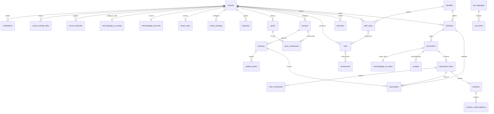

# Esquema de base de datos: estado actual

**Corte:** esquema y migraciones versionados en `main` al iniciar este cambio. Este documento resume el estado funcional y las migraciones recientes; no afirma qué migraciones están aplicadas en producción.

## Fuentes de verdad

- Negocio: [`api/prisma/schema.prisma`](../api/prisma/schema.prisma), junto con [`ads.prisma`](../api/prisma/ads.prisma) y [`mercadopago-qr.prisma`](../api/prisma/mercadopago-qr.prisma).
- Historial: [`api/prisma/migrations/`](../api/prisma/migrations/).
- Chat: [`chat-api/prisma/schema.prisma`](../chat-api/prisma/schema.prisma), en una base separada.
- El documento detallado anterior, [`09-esquema-db.md`](./09-esquema-db.md), conserva las descripciones extensas de tablas y reglas; sus tablas de migraciones no incluyen los cambios recientes listados abajo.

## Mapa funcional

**Lectura rápida:** `tenants` es el límite de datos de cada organización. `identities` representa la cuenta de una persona; `members` y `staff_users` son sus perfiles dentro de una organización. Catálogo, sesiones y reservas cubren la actividad; `transactions` y sus `transaction_items` representan el cobro y lo vendido. Las tablas de acceso registran intentos/vínculos; las tablas de avisos, gastos, recibos, sitios y configuración cubren la operación alrededor.

El diagrama expresa relaciones funcionales. No todas las líneas son claves foráneas físicas; en particular, las migraciones de Point QR no declaran FK desde `tenant_id` o `transaction_id` hacia las tablas correspondientes. `access_credentials` sigue en el esquema como legado.

## Cambios recientes en el esquema de negocio

| Migración | Cambio |
|---|---|
| `20261006120000_faciliter_ads` | Crea `ad_campaigns` (campañas) y `ad_events` (eventos de campaña). `ad_events.campaign_id` sí referencia la campaña; `tenant_id` es un valor indexado sin FK declarada. |
| `20261007120000_mercadopago_qr_setup` | Crea `mercadopago_qr_setups`: configuración Point por organización (`tenant_id` como PK, `mp_user_id`, `store_id`, `pos_id`). La migración no declara FK a `tenants`. |
| `20261008120000_mp_point_qr_orders` | Crea `mercadopago_qr_orders`: orden y datos QR asociados a la transacción; `transaction_id` y `mp_order_id` son únicos, sin FK declaradas. |
| `20261009120000_mp_payment_discounts` | Añade a `tenant_settings` `mp_point_qr_discount_bps` (default 500 = 5 %) y `mp_link_discount_bps` (default 0). |
| `20261010120000_pack_landing_visibility` | Añade `packs.show_on_landing`, booleano con default `true`; permite ocultar packs individuales de la web pública. |

Estas migraciones complementan las áreas de identidad y perfiles, altas self-service, notificaciones, importaciones, gastos, acceso ZKTeco, sitios públicos, débitos, cobros y transferencias documentadas en la historia previa.

## Otras bases de datos

`chat-api` usa una base `chat` aparte, sin FK hacia las tablas de negocio: `identities`, `conversations` y `messages`. Las conversaciones pertenecen a mensajes; la identidad de chat se identifica por `(tenant_id, user_id)`. El esquema está en el archivo Prisma enlazado arriba.

## Cómo interpretar este estado

El esquema en Prisma más las migraciones versionadas describen lo que el código espera. No consulté una base activa ni la tabla `_prisma_migrations`; por eso este documento **no confirma** que producción tenga aplicadas todas las migraciones. Para desplegar, consultar el estado del entorno y ejecutar el procedimiento de [`13-setup-db-desde-cero.md`](./13-setup-db-desde-cero.md) según corresponda.

[Índice](./00-indice.md) · [Detalle anterior de tablas y reglas](./09-esquema-db.md) · [Setup de DB](./13-setup-db-desde-cero.md)
